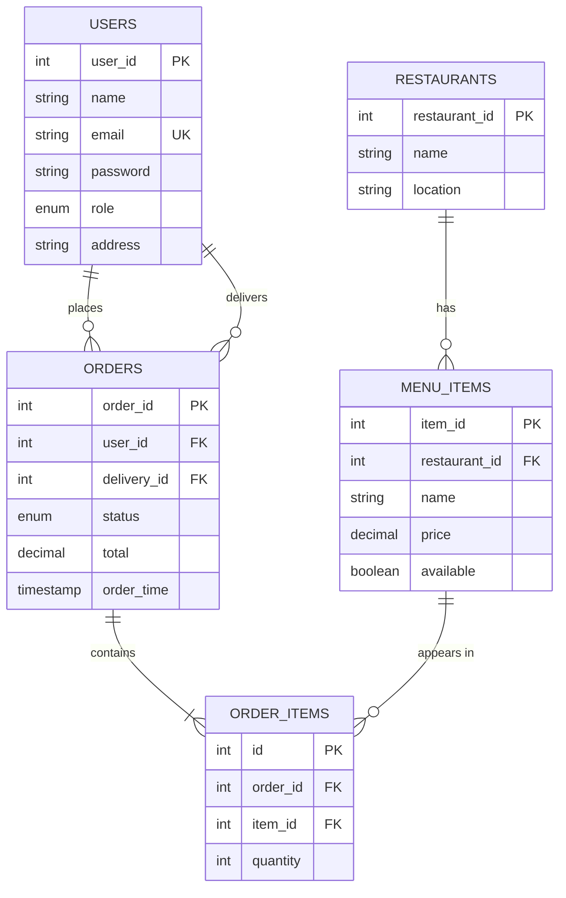
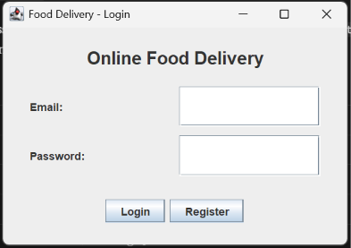
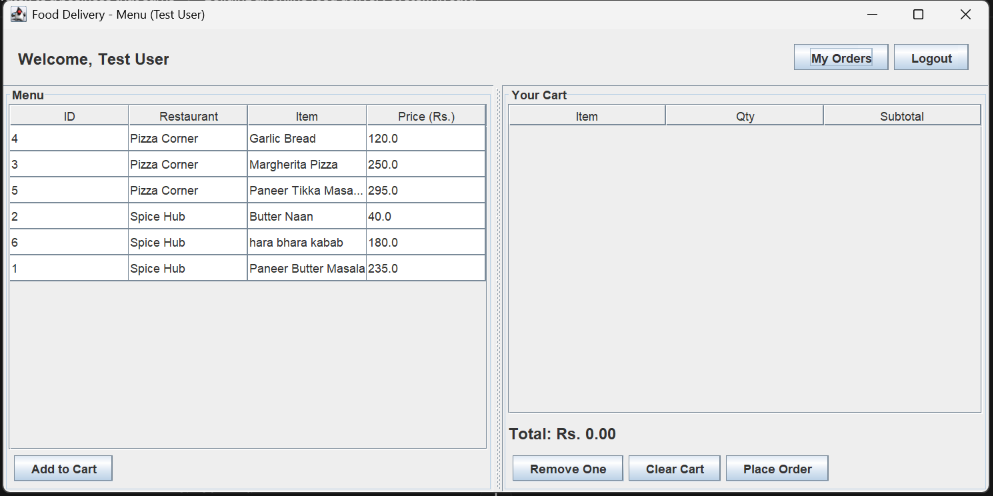
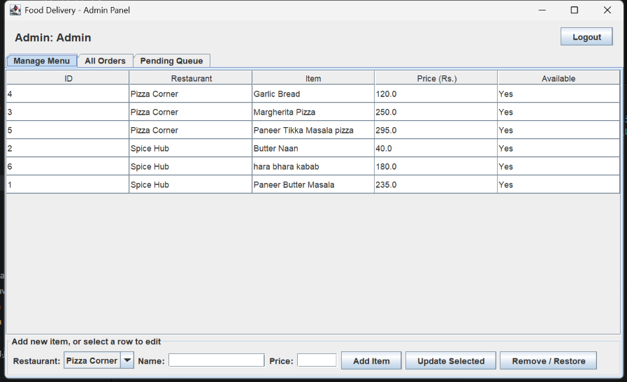
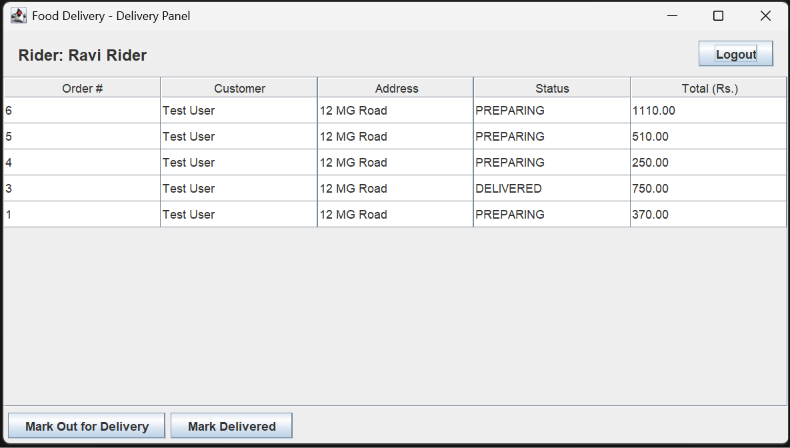
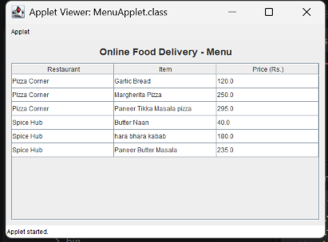

# Online Food Delivery Management System

A desktop application for ordering food online, built with Java Swing and MySQL. It has three roles (customer, admin, delivery person) and a full order lifecycle from placing an order to delivery.

## Features

**Customer**
- Register and log in
- Browse the menu (loaded from MySQL)
- Add dishes to a cart, see the running total
- Place an order (saved in one database transaction)
- Track order status live in "My Orders"

**Admin**
- Add, edit, and remove (hide) menu items
- View all orders, refreshed automatically
- Assign an order to a delivery person
- Pending Queue: serves the oldest waiting order first (FIFO)

**Delivery person**
- See assigned orders with the customer's name and address
- Mark orders Out for Delivery, then Delivered

## Requirements Covered

| Requirement | Where it is used |
|---|---|
| GUI components | Swing: `JFrame`, `JDialog`, `JTable`, `JTabbedPane`, `JComboBox`, layouts |
| Applet | `applet-demo/MenuApplet.java` hosts `MenuPanel` inside a `JApplet` |
| JDBC / MySQL | `dao/` classes using `PreparedStatement`, joins, and transactions |
| Collections | `ArrayList` (menu), `LinkedHashMap` (cart), `Queue`/`LinkedList` (pending orders) |
| Multithreading | Background threads that auto-refresh My Orders, Admin, and Delivery screens |

## Tech Stack

Java 17, Swing, JDBC, MySQL 8, MySQL Connector/J, Git

## Project Structure

```
FoodDelivery/
├── src/
│   ├── Main.java
│   ├── model/    User, MenuItem, Cart
│   ├── dao/      UserDAO, MenuDAO, OrderDAO   (all SQL lives here)
│   ├── util/     DBConnection
│   └── ui/       LoginFrame, RegisterDialog, MenuFrame, MyOrdersDialog,
│                 AdminFrame, DeliveryFrame, MenuPanel
├── applet-demo/  MenuApplet.java, menu.html, applet.policy
├── lib/          MySQL Connector/J jar
├── schema.sql
└── db.properties.example
```

The UI classes never write SQL. They call DAO methods, so the layers stay separate.

## Database Design



Tables: `users`, `restaurants`, `menu_items`, `orders`, `order_items`. Full script in `schema.sql`.

## Setup

1. Install JDK 17 and MySQL Server.
2. Run `schema.sql` in MySQL Workbench to create the database and sample data.
3. Copy `db.properties.example` to `db.properties` and enter your MySQL password.
4. Make sure the MySQL Connector/J jar is in the `lib/` folder.
5. Open the project folder in VS Code (with the Extension Pack for Java) and run `src/Main.java`.

## Demo Accounts

| Role | Email | Password |
|---|---|---|
| Admin | admin@food.com | admin123 |
| Delivery | ravi@food.com | ravi123 |
| Customer | Register a new account from the login screen | |

## Running the Applet Demo

Applets are removed from modern Java and browsers, so the main application uses Swing. The applet demo shows the same `MenuPanel` inside a `JApplet` and needs JDK 8 (with `appletviewer`).

```powershell
$JDK8 = "path\to\jdk-8"
Copy-Item lib\mysql-connector-j-26.10.0.jar applet-demo\mysql.jar
& "$JDK8\bin\javac" -cp applet-demo\mysql.jar -sourcepath src -d applet-demo applet-demo\MenuApplet.java
& "$JDK8\bin\appletviewer" "-J-Djava.security.policy=applet-demo/applet.policy" applet-demo/menu.html
```

Run from the project root so `db.properties` is found.

## Screenshots

| Login | Customer menu and cart |
|---|---|
|  |  |

| Admin panel | Delivery panel |
|---|---|
|  |  |



## Design Decisions

- **Transactions:** placing an order inserts into `orders` and `order_items` together. If one fails, everything rolls back.
- **Soft delete:** removing a menu item sets `available = FALSE`, so old orders keep their references.
- **`PreparedStatement` everywhere:** prevents SQL injection.
- **Order lifecycle:** PLACED, PREPARING, OUT_FOR_DELIVERY, DELIVERED, enforced in the code.

## Future Work

- Hash passwords with BCrypt (currently stored as plain text)
- Use `BigDecimal` for money instead of `double`
- Order cancellation and customer reviews
- Connection pooling instead of a new connection per query

## Author

Shivang,Vishad,Aditya,Holiyan,Geffry